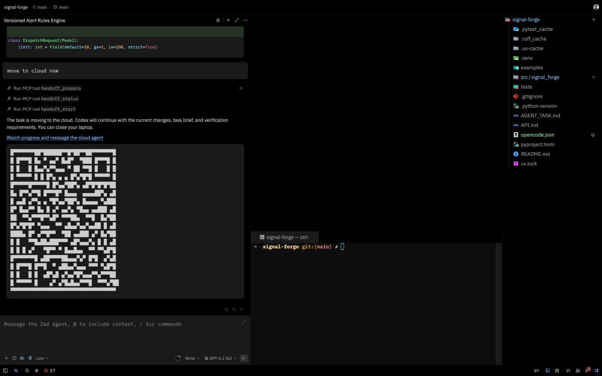
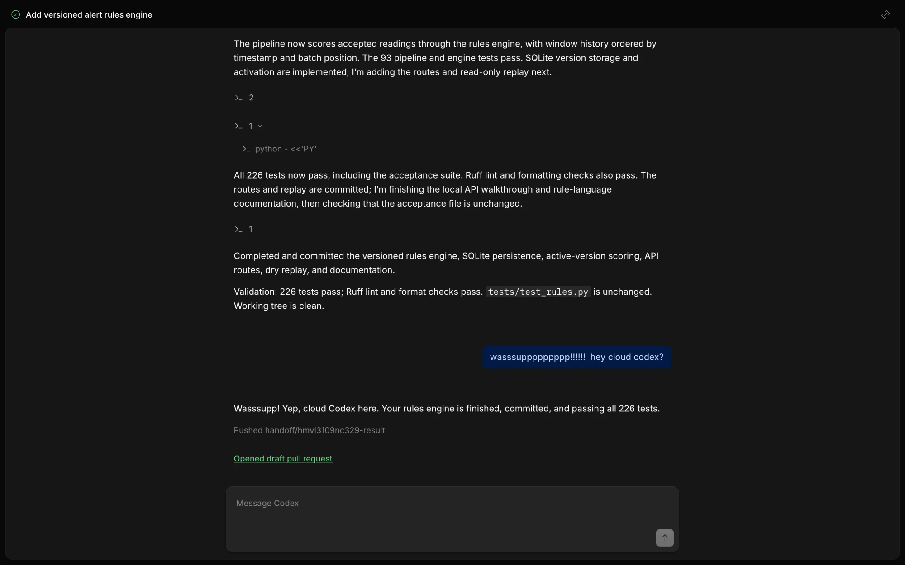

# Agent Handoff

Move a coding agent's task and its unfinished work from your machine to a cloud sandbox or your own SSH machine. The task keeps running after your laptop disconnects, continued by the same agent or a different one.

Tell your agent something like "I need to leave, keep going in the cloud." The agent infers the intent, warms a sandbox, writes a handoff brief, and hands off. You do not need a special phrase or a terminal command.

It works from any agent that supports MCP and from any editor or terminal.

## A real handoff

The Zed agent hands a half-built feature to Codex in an E2B sandbox and returns a watch link and a QR code.



On the watch page, Codex finishes the work, answers a message, pushes the result branch, and opens a draft pull request.



## Supported agents

| Agent | Can start a handoff | Can continue in the sandbox | Moves its full session |
| --- | --- | --- | --- |
| OpenCode 2 | Yes | Yes | Yes |
| Claude Code | Yes | Yes | Not yet. The brief carries the context |
| Codex | Yes | Yes | Not yet. The brief carries the context |
| Pi | Yes | Yes | Not yet. The brief carries the context |
| Prime Agent | Yes, over HTTP | No headless mode yet | No |
| Zed agent | Yes | No | No |
| Other MCP clients | Yes, after you add the server yourself | No | No |

## Supported sandbox providers

| Provider | SSH for your editor | Reusable cache | Notes |
| --- | --- | --- | --- |
| Daytona | Yes | No | Keeps the sandbox awake with a heartbeat while the agent works |
| Your own SSH machine | Yes | No | Needs key-based login, git, and Node.js on the machine |
| E2B | No | Yes | Free tier stops runs after 1 hour, then pauses the sandbox |
| Vercel Sandbox | No | No | Hobby tier stops runs after 45 minutes |
| Prime Intellect | Yes | Yes | Needs `uv` installed locally. Has no free tier |

## Requirements

- Node.js 22 or later.
- A Git repository with an `origin` remote. GitHub is required for the draft pull request.
- A GitHub token that can read the repository, push branches, and create pull requests. For a fine-grained token:
  - Set **Repository access** to "All repositories" or select the repository. "Public repositories" is read-only and cannot push.
  - Set **Contents** and **Pull requests** to read and write. **Metadata** read-only is added automatically.
  - Add **Workflows** read and write only if the agent may edit files in `.github/workflows/`.
- An account with one sandbox provider, or an SSH machine.
- A model key or login for the agent that continues in the sandbox.

## Set up

1. Build the server:

   ```bash
   npm install
   ```

   ```bash
   npm run build
   ```

2. Run the setup wizard:

   ```bash
   node dist/index.js setup
   ```

   The wizard uses the same prompts as `npx skills add`. It:
   - asks for a sandbox provider, and checks SSH access when you pick `ssh`;
   - asks for the provider keys and `GITHUB_TOKEN` that are not already set (input is masked, and Enter skips a key);
   - asks which agents can continue your work in the cloud: OpenCode, Codex, Claude Code, or Pi;
   - asks only for the keys those agents need, and skips an agent that already has a login or a key (OpenCode uses your OpenCode login, and Codex uses `~/.codex/auth.json`);
   - when you pick more than one agent, asks which one is the default. The calling agent can still name another one for a single handoff;
   - detects the agents and editors on your machine and asks which ones get the MCP server. OpenCode, Claude Code, and Codex are registered with their own `mcp add` command. Pi and the Zed agent are registered by adding an `agent-handoff` entry to their MCP config file (`~/.pi/agent/mcp.json`, and `context_servers` in Zed's settings), which keeps your existing servers and comments. Pi gets the file because older Pi versions have no `mcp add` command. Running setup again replaces the entry instead of adding a second one;
   - when you run setup through `npx`, copies agent-handoff to `~/.local/share/agent-handoff` (`%LOCALAPPDATA%\agent-handoff` on Windows) and registers that copy. The npx cache is temporary, so agents registered against it would break when npm clears it. A source checkout is registered where it is;
   - installs an `agent-handoff` command in `~/.local/bin`, or `%LOCALAPPDATA%\agent-handoff\bin` on Windows, and tells you when that folder is not on your PATH;
   - asks which agents get the handoff skill, and whether to install it in the project or globally. Codex, Pi, and the Zed agent share the `.agents/skills` folder, so they get one copy;
   - shows a summary and asks you to confirm before it writes anything.

   Press Ctrl+C at any prompt to cancel without changing anything. The wizard needs an interactive terminal.

3. Reload your agents so they pick up the server.

### Update

```sh
agent-handoff update
```

This installs the newest agent-handoff and repeats what setup did with the choices you made then: the install copy, the command, the MCP server registration in every agent, and the handoff skill. It asks no questions. Agents that are already running switch to the new version on their next tool call, without a restart.

Your first update after installing a version without `update` needs setup instead: run `npx github:bamiboy237/agent-handoff setup` once, then reload your agents. Every update after that works with the command.

### Where settings live

- Provider choice and defaults: `~/.config/agent-handoff/config.json`.
- Keys: `~/.config/agent-handoff/.env`, readable only by you. The server reads this file on every call, so a changed key takes effect without restarting your agent.
- The server also reads keys from its own environment. The secrets file wins when both set a key.
- Environment overrides for one-off runs: `AGENT_HANDOFF_PROVIDER`, `AGENT_HANDOFF_TARGET_AGENT`, and `AGENT_HANDOFF_SSH_HOST`.

### Connect an agent by URL

Prime Agent and other clients that connect by URL use the HTTP transport. It listens on localhost only.

```bash
node dist/index.js --http 7878
```

```bash
prime-agent mcp add agent-handoff --url http://127.0.0.1:7878/mcp
```

## Use it

1. Work with your agent as usual.
2. Tell the agent you want the work to continue remotely. Name an agent if a different one should finish it, for example "let Codex finish this in the cloud."
3. The agent calls `handoff_prepare` with a brief, reports any warnings, and then calls `handoff_start`.
4. The agent ends its turn. The transfer continues in the background.
5. Check in while it works, through your agent or from a terminal (see [Check in on a handoff](#check-in-on-a-handoff)).
6. When the remote agent finishes, review the draft pull request on GitHub.

## Watch from your phone

When a handoff starts, your agent gives you a watch link and a QR code. Open it on any device, such as your phone, to follow the cloud agent live and send it messages after you close your laptop.

- With OpenCode as the cloud agent, the link opens OpenCode's own web app, signed in to the sandbox's session. You can read the whole session, see the changes, and type to the agent.
- With Claude Code, Codex, or Pi, the link opens a live page of the agent's output with a message box. Messages reach the agent when its current turn ends.
- The link carries a secret key, so anyone who has it can watch and message the agent. Share it only with people you trust.
- On Daytona, the link is a signed preview URL. It lasts 24 hours and renews whenever you check status. Daytona shows a one-time warning page before it; [your organization can turn that off](https://www.daytona.io/docs/en/preview-and-authentication). On E2B, the link lasts as long as the sandbox.
- The Vercel Sandbox, SSH host, and Prime Intellect providers do not offer public URLs yet, so they have no watch link.

## Check in on a handoff

Ask your agent for an update, what changed, or to tell the cloud agent something new. Or run these from the repository in a terminal. Without an ID, each command uses the newest handoff for the current repository.

| Command | What it does |
| --- | --- |
| `agent-handoff status [id]` | Shows the state, recent remote log, draft pull request, and SSH details. |
| `agent-handoff work [id] [--diff]` | Lists the cloud agent's commits and changed files since the handoff. `--diff` adds the full diff. |
| `agent-handoff logs [id] [-f]` | Prints the remote log. `-f` keeps following it until the run ends. |
| `agent-handoff send [id] "message"` | Sends the cloud agent new instructions. A running agent reads them when its current turn ends and continues in the same session. A finished run resumes to answer them, then updates the result branch and pull request. |
| `agent-handoff ssh [id]` | Opens a shell in the sandbox, in the project folder. Needs a provider with SSH. |
| `agent-handoff attach [id]` | Opens OpenCode's live session in your terminal over an SSH tunnel, so you can watch and type into it. Quitting leaves the cloud agent running. Needs OpenCode as the cloud agent and a provider with SSH. |
| `agent-handoff watch [id] [--open]` | Prints the watch link and its QR code. `--open` opens it in your browser. |
| `agent-handoff stop [id]` | Stops the cloud agent and its sandbox. Pushed branches stay. |

## The handoff brief

The calling agent writes a brief with these fields. It is the continuation context for every remote agent, and the only context when the full session cannot move.

| Field | Contents |
| --- | --- |
| `title` | One line naming the work. Also the pull request title |
| `task` | The goal and constraints |
| `done` | What is finished, including uncommitted edits |
| `decisions` | Choices made and why |
| `files` | Files that matter for the next step |
| `nextStep` | The exact next action |
| `verification` | How to check the work |

## Tools

| Tool | Purpose |
| --- | --- |
| `handoff_prepare` | Checks the repository and keys, returns warnings, and warms a sandbox in the background. Takes `brief`, and optionally `targetAgent`, `model`, and `projectDir`. `model` is in the cloud agent's own format, such as `opencode/big-pickle`; without it, the model chosen in setup applies, then the agent's default. |
| `handoff_start` | Starts the transfer. Takes `handoffId`, or a `brief` to prepare and start in one call. Repeated calls never launch a second remote agent. |
| `handoff_status` | Returns the state, recent events, the remote log, the draft pull request, and SSH details when the provider supports SSH. |
| `handoff_work` | Lists the cloud agent's commits and changed files since the handoff. Set `diff` for the full diff. |
| `handoff_message` | Sends the cloud agent new instructions. A running agent reads them when its turn ends; a finished run resumes to answer them. |
| `handoff_stop` | Stops the helper and the sandbox. Pushed branches stay on the remote. |

### Handoff states

| State | Meaning |
| --- | --- |
| `warming` | Creating the sandbox and installing the remote agent. |
| `warm` | The sandbox is ready and waits for `handoff_start`. |
| `waiting_for_idle` | Waiting for the local turn to end. Only for agents that identify their session. |
| `transferring` | Pushing the snapshot branch and exporting the session. |
| `setting_up` | Cloning the project and installing dependencies in the sandbox. |
| `running` | The remote agent is working. |
| `completed` | The remote agent finished and the result branch is pushed. |
| `failed` | A step failed. `handoff_status` names the step. |
| `stopped` | Stopped with `handoff_stop`. |
| `abandoned` | `handoff_start` never came within 20 minutes. The warm sandbox was deleted. |

## Configure the project setup

The server detects dependencies from these lockfiles at the repository root:

| Lockfile | Install command |
| --- | --- |
| `pnpm-lock.yaml` | `pnpm install --frozen-lockfile` |
| `yarn.lock` | `yarn install --frozen-lockfile` |
| `bun.lock`, `bun.lockb` | `bun install --frozen-lockfile` |
| `package-lock.json` | `npm ci` |
| `uv.lock` | `uv sync --frozen` |
| `poetry.lock` | `poetry install` |
| `requirements.txt` | `pip install -r requirements.txt` |
| `Cargo.lock` | `cargo fetch --locked` |
| `go.sum` | `go mod download` |
| `Gemfile.lock` | `bundle install` |

To add system packages, services, or build steps, create `.handoff.json` at the repository root. The commands run in order after the detected installs:

```json
{
  "setup": [
    "sudo apt-get update && sudo apt-get install -y postgresql-client",
    "npm run build"
  ]
}
```

## Credentials

`GITHUB_TOKEN` must be able to push to the repository: Contents read and write, plus Pull requests read and write. `handoff_prepare` refuses a token that can only read, because the run would end with its commits stuck in the sandbox. If a push still fails, the run ends as `failed:push`, git's error shows in the remote log and on the watch page, and the commits stay in the sandbox.

The sandbox receives these values as environment variables. A plain SSH machine receives them in a file readable only by your user in the handoff's directory. They never go into the snapshot branch, the brief, or the handoff record.

- Model keys for the remote agent:
  - OpenCode: API keys from OpenCode's credential store.
  - Claude Code: `ANTHROPIC_API_KEY`, or `CLAUDE_CODE_OAUTH_TOKEN` from `claude setup-token`.
  - Codex: `CODEX_API_KEY` or `OPENAI_API_KEY`, or your ChatGPT login from `~/.codex/auth.json`.
  - Pi: `ANTHROPIC_API_KEY`, `OPENAI_API_KEY`, `GEMINI_API_KEY`, or `OPENROUTER_API_KEY`.
- Every value in the project's `.env` and `.env.local` files.
- `GITHUB_TOKEN`.

`handoff_prepare` refuses to start when GitHub rejects the token.

Untracked files that are not gitignored go into the snapshot branch. `handoff_prepare` warns when such a file looks like a secret, for example `.env.production`.

## How it works

1. `handoff_prepare` records the handoff and starts a detached helper process.
2. The helper creates a sandbox and installs the remote agent. When the provider supports a cache and a matching one exists, the sandbox starts from it.
3. `handoff_start` signals the helper and returns. The agent ends its turn.
4. The helper captures the work:
   - For an agent that identifies its session (OpenCode), it waits for the turn to end, then snapshots.
   - For other agents, `handoff_start` snapshots immediately.
5. The snapshot is one commit of committed, staged, unstaged, and new files, built with a temporary Git index. Your working tree, index, and branch stay unchanged. It is pushed as `handoff/<id>`.
6. In the sandbox, the runner clones the branch, creates `handoff/<id>-result`, and runs the setup. The helper then saves a cache when the provider supports one.
7. The runner starts the remote agent with the brief, and with the imported session when the agent can resume it. Every permission is auto-approved inside the sandbox.
8. When the agent finishes, the runner commits leftover changes, pushes the result branch, and opens a draft pull request against your original branch.

Handoff records and helper logs live in `~/.local/state/agent-handoff/`.

## Limits

- The local session is read-only by convention only. The handoff cannot block further edits.
- Unsaved editor buffers are not transferred. Save files before you hand off.
- Only OpenCode sessions move in full today. Other agents continue from the brief.
- Messages reach Claude Code, Codex, and Pi between turns, not mid-turn, because they run headless. Use `attach` with OpenCode to steer mid-turn.
- When a remote run fails, the next status check stops its sandbox. The pushed result branch keeps any partial work.
- Free tiers cap run time: 45 minutes on Vercel Hobby and 1 hour on E2B Hobby. Raise the limits with `AGENT_HANDOFF_VERCEL_LIFETIME_MINUTES` or `AGENT_HANDOFF_E2B_LIFETIME_MINUTES` on paid plans.
- Prime Intellect has no stop or pause, so `handoff_stop` deletes the sandbox.
