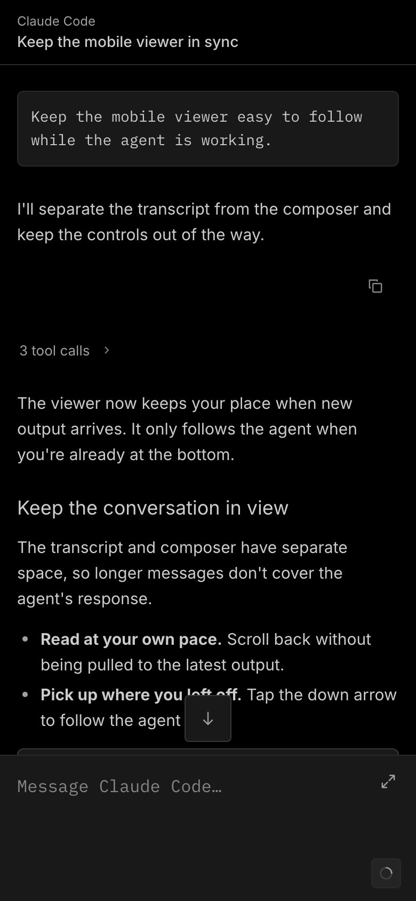
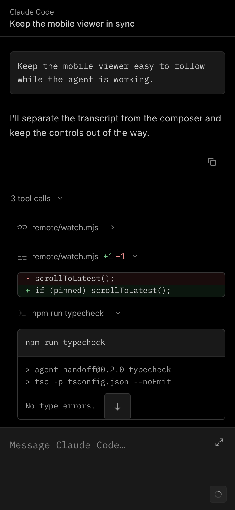
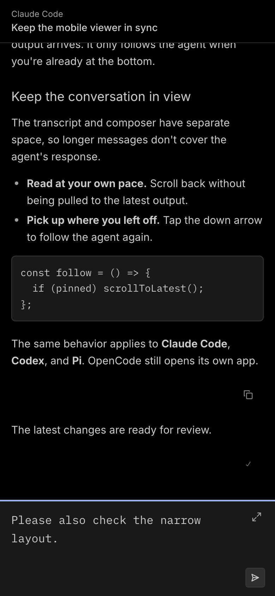
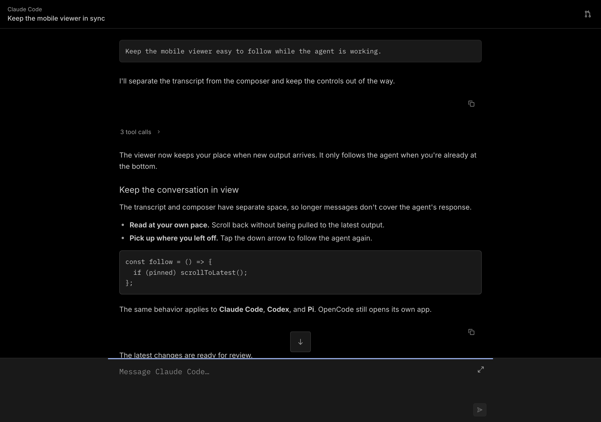

# Mobile viewer: Zed-inspired redesign

The supplied Zed agent-panel screenshot is the visual reference. This changes
the built-in watch page for Claude Code, Codex and Pi, plus OpenCode's startup
fallback. OpenCode's own web app and the marketing site are unchanged.

## What carries over

- Black conversation surface with a single hairline below the title.
- Neutral `#191919` prompt and code blocks, `#cccccc` text, and `#373737`
  control borders. No blue chat bubbles, floating panel, gradients or shadows.
- Full-width, left-aligned monospace prompts; proportional assistant text and
  regular-weight headings.
- A flush bottom composer: expand at the upper right and one send/progress
  control at the lower right.
- 16px chrome icons with a rendered 1.2px outline, small corner radii, and muted
  controls. Tap areas are 44px rather than desktop-sized targets.
- Copy actions below responses and visible chevrons for folded tool calls.

## Adaptations for handoff

Only functioning controls appear. The agent name sits at the top-left of the
header, above the task title. A PR icon appears when a result is available.
The lock and redundant agent and tool-summary icons are omitted. Unsupported
attachment, new-thread and model-switching controls are not shown.

Tool summaries use plain disclosure rows rather than bordered chips.
Paths use readable muted text, and tighter spacing connects each tool to its
output. Prompt, code, shell, and diff blocks share a 6px corner radius.
The enabled send icon is brighter than its disabled state.

The composer expands without losing the draft, collapses with its button or
Escape, and returns to the conversation after a successful send. Safe-area
insets, dynamic viewport height, a 16px textarea (avoiding iOS focus zoom),
reduced motion and keyboard focus are preserved.

The send control shows a paper plane when idle. While the agent works and the
composer is empty, a working ring replaces it. Typing a message restores the
paper plane so the user can send another instruction. The ring also appears
while a message request is in flight.

The ring rotates once per second with linear timing. Reduced motion keeps the
same ring still. There is no visible "Working" row; short run-state updates
remain available to screen readers. Errors and reconnect notices remain visible.
Tool disclosures respond on press, and the composer has a contrasting focus bar.
Nested code and output blocks use thin scrollbars.

The event stream uses byte offsets to resume after a dropped connection.
Reconnects append missed output without rebuilding earlier messages, so reading
position, open tool details, focus, and the message draft stay intact.
If the log shrinks, the server explicitly resets the transcript.
Screen readers receive short activity updates rather than every tool result.

This is a close visual adaptation, not a claim of pixel-identical Zed rendering:
the existing embedded fonts and OpenCode tool icons remain. New chrome icons
are original inline outlines; no Zed application source or icon assets were
imported. The watch server still has no runtime dependencies or external assets.

## Review screenshots

These are browser captures of the actual watch page served with a **synthetic
Claude Code transcript**, not a live cloud run. All use device scale factor 2.

| Conversation, 390 × 844 CSS px | Expanded tools, 390 × 844 CSS px |
| --- | --- |
|  |  |





## Reproduce

Use Node.js 22 or later (CI uses 24):

```sh
npm ci
npx playwright install --with-deps chromium webkit
npm run test:watch
WATCH_BROWSER=webkit npm run test:watch
```

To refresh the screenshots:

```sh
WATCH_SCREENSHOT_DIR=docs/images npm run test:watch
```

The test starts the real watch server in a temporary directory. It checks
authentication, SSE rendering, tool/diff/shell expansion, copying, composer
expansion and draft preservation, failed sends, successful inbox delivery,
send/working icon transitions, reduced motion, completion/error states, the PR
link, and cursor-based reconnects with and without missed output. It also checks
transcript reset after log truncation,
scroll position, open details, focus, draft retention, long content, and all
tool types at phone, landscape, and desktop dimensions.

Chromium and WebKit emulation are not substitutes for a physical iPhone:
Safari's software keyboard and hardware safe areas still need a device check.

## Test the viewer in a browser

Start the local preview from the repository root:

```sh
npm run preview:watch
```

Open the printed localhost URL. The preview serves a synthetic transcript and
accepts test messages. It starts no coding agent or cloud sandbox, and it never
reads a real handoff inbox. Press Ctrl+C to stop it.

The preview listens on loopback by default. To test from a phone on your local
network, run:

```sh
HOST=0.0.0.0 npm run preview:watch
```

On the phone, replace `localhost` in the printed URL with your computer's LAN
IP address. This exposes synthetic preview data to your network; it is not a
production watch link. Clipboard access can require HTTPS on a phone.
Check the keyboard, landscape, safe areas, and scrolling on the device.
